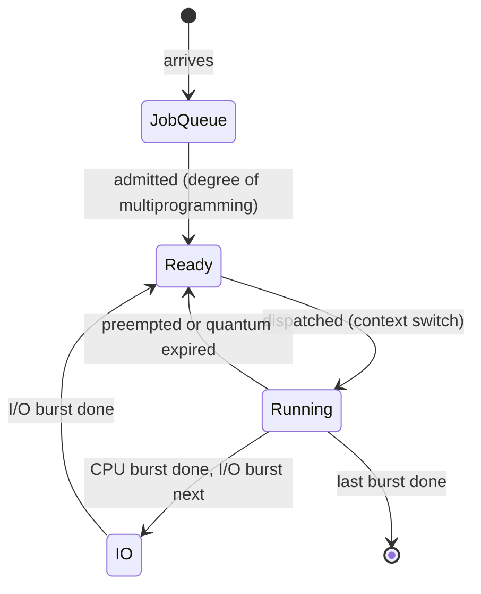

# Process Scheduling Simulator

A Java simulator of how an operating system schedules processes on a CPU. It runs six classic scheduling algorithms on the same workload and compares them side by side.

Each process alternates between CPU bursts and I/O bursts, like a real program. The simulator moves processes through the job queue, the ready queue and the device queue one time unit at a time. It charges time for every context switch, and it limits how many processes can be in memory at once (the degree of multiprogramming). For every algorithm it reports waiting, turnaround and response times, CPU utilization, throughput and the number of context switches, and draws a Gantt chart of what the CPU did.

## Algorithms

| Algorithm | Runs next | Preemptive |
|---|---|---|
| FCFS | the process that became ready first | no |
| SJF | the shortest next CPU burst | no |
| SRTF | the shortest remaining CPU burst | yes, when a shorter job becomes ready |
| Priority | the lowest priority number | yes, when a more important job becomes ready |
| Round Robin | the next process in FIFO order | yes, when its time quantum runs out |
| SJF + exponential averaging | the shortest *predicted* CPU burst | no |

SJF and SRTF assume the length of the next CPU burst is known, which a real operating system can't know. The exponential-averaging scheduler is the realistic version: it predicts each process's next burst from its past bursts with τ(n+1) = α·t(n) + (1 − α)·τ(n).

## Quick start

You need a JDK, Java 8 or newer.

```bash
make test                               # run the 35 checks
make example                            # classic 4-process example, with Gantt charts
make run                                # random workload of 20 processes
make run ARGS="--seed 7 --mp 4 --gantt" # any options, see below
```

Without `make`:

```bash
javac -d out src/*.java
java -cp out Main --example
```

## Example: the classic textbook workload

`make example` runs the 4-process example used in most operating systems textbooks for SRTF (arrivals 0 to 3, bursts 8, 4, 9 and 5), with priorities added:

```
PID   Arrival  Priority  Bursts
P1          0         3  CPU(8)
P2          1         1  CPU(4)
P3          2         4  CPU(9)
P4          3         2  CPU(5)

Algorithm               Avg wait  Avg turnaround  Avg response  CPU busy  Throughput  Context switches
FCFS                        8.75           15.25          8.75    100.0%       15.38                 3
SJF                         7.75           14.25          7.75    100.0%       15.38                 3
SRTF                        6.50           13.00          4.25    100.0%       15.38                 4
Priority                    6.50           13.00          4.25    100.0%       15.38                 4
Round Robin (q=4)          11.75           18.25          4.50    100.0%       15.38                 7
SJF + exp. averaging        8.75           15.25          8.75    100.0%       15.38                 3

SRTF
| P1 | P2 | P4 | P1 | P3 |
0    1    5    10   17   26

Round Robin (q=4)
| P1 | P2 | P3 | P4 | P1 | P3 | P4 | P3 |
0    4    8    12   16   20   24   25   26
```

At time 1, P2 (4 units) arrives and preempts P1, which still has 7 units left. That's why SRTF gets the lowest average waiting time, 6.5, the same as the textbook answer. Each process here has a single CPU burst, so the exponential-averaging scheduler has no history to learn from and behaves like FCFS.

## Example: a random workload

`make run` generates 20 processes (seed 42) with about 3 CPU bursts each, I/O between them, and a context switch cost of 1 time unit:

```
Algorithm               Avg wait  Avg turnaround  Avg response  CPU busy  Throughput  Context switches
FCFS                      326.00          383.15         63.80     86.4%        3.57                69
SJF                       237.60          294.75        117.15     84.2%        3.48                68
SRTF                      234.30          291.45        110.30     82.3%        3.40                81
Priority                  234.65          291.80        194.60     84.8%        3.50                77
Round Robin (q=4)         377.15          434.30         37.65     76.3%        3.15               143
SJF + exp. averaging      280.65          337.80         95.15     84.2%        3.48                68
Throughput = processes finished per 100 time units.

Lowest average waiting time : SRTF, 28% lower than FCFS
Fastest average response    : Round Robin (q=4)
```

- SRTF waits the least, but Round Robin answers fastest, because no process can hold the CPU for more than one quantum at a time. Round Robin pays for it with about twice as many context switches as FCFS and the lowest CPU utilization.
- Predicting bursts with exponential averaging cuts the average wait by 14% compared with FCFS, without knowing any burst lengths in advance.

## What the simulator shows

### Multiprogramming keeps the CPU busy

With FCFS on the same workload, changing only the degree of multiprogramming (`make run ARGS="--mp 1"`, and so on):

| Processes in memory | 1 | 2 | 3 | 4 | 8 | all 20 |
|---|---:|---:|---:|---:|---:|---:|
| CPU busy | 41.4% | 66.9% | 82.7% | 85.7% | 86.3% | 86.4% |
| Throughput | 1.71 | 2.76 | 3.42 | 3.54 | 3.57 | 3.57 |

With one process in memory, the CPU sits idle every time that process does I/O. A few more processes give the CPU something to run during I/O, and after about 4 the gain levels off.

### Choosing the time quantum

Round Robin on the same workload, with a context switch costing 1 time unit:

| Quantum | 1 | 2 | 4 | 8 | 16 |
|---|---:|---:|---:|---:|---:|
| Avg response | 18.50 | 26.75 | 37.65 | 54.95 | 63.80 |
| CPU busy | 49.4% | 64.8% | 76.3% | 82.7% | 86.4% |
| Context switches | 477 | 255 | 143 | 93 | 69 |

A small quantum gives fast response, but half the CPU time goes to context switches. A large quantum wastes nothing, but once it is longer than every burst, Round Robin turns into FCFS: the quantum-16 numbers are exactly FCFS's.

## How the simulation works



Time moves in whole units. Every unit has five steps:

1. **Admit:** arrived processes move from the job queue to the ready queue while fewer than the degree of multiprogramming are in memory.
2. **Preempt:** SRTF and Priority take the CPU back if a better process is ready; Round Robin does when the quantum is used up.
3. **Dispatch:** a free CPU takes the head of the ready queue. Switching to a different process costs the context-switch time.
4. **Run:** the CPU does one unit of work, and every process in the device queue does one unit of I/O, so I/O and CPU work overlap.
5. **Move on:** a process whose CPU burst ended goes to I/O, back to the ready queue, or out of the system.

How the results are measured:

- **Turnaround** = completion time − arrival time
- **Waiting** = time in the system spent neither running nor doing I/O: in the job queue, in the ready queue or being switched in
- **Response** = first time on the CPU − arrival time
- **CPU busy** = share of time spent running processes; idle time and context switches don't count
- **Throughput** = processes finished per 100 time units

## Code structure

```
src/
  Main.java                    command line and output; runs the six algorithms in parallel threads
  Scheduler.java               the simulation loop shared by every algorithm (abstract base class)
  FirstComeFirstServed.java    ShortestJobScheduler.java     PreemptiveShortestJob.java
  PriorityScheduling.java      RoundRobinScheduler.java      ExponentialAveraging.java
  ReadyOrderSorter.java        CPUBurstDurationSorter.java   ProcessPrioritySorter.java
  ProcessExpAverageSorter.java ProcessArrivalSorter.java     comparators that order the queues
  Process.java, Burst.java     the process model
  WorkloadGenerator.java       seeded random workloads
  SimulationResult.java        metrics and Gantt chart
tests/
  SchedulerTests.java          textbook examples and invariant checks
```

- **One loop, six policies.** The simulation loop is written once, in `Scheduler`. Each algorithm only supplies a comparator for the ready queue and a rule for when to preempt.
- **Heap-based ready queue.** The ready queue is a `PriorityQueue`, so picking the next process takes O(log n) for every algorithm.
- **Fair comparison.** Every algorithm runs on its own deep copy of the same workload, and the same seed always produces the same workload.
- **Parallel runs.** Because the copies share nothing, the six simulations run on separate threads (`ExecutorService`) without any locks.

## Tests

`make test` runs 35 checks:

- **Worked examples** from *Operating System Concepts* (Silberschatz, Galvin and Gagne), average waiting time:

  | FCFS | SJF | SRTF | Priority | Round Robin, q=4 |
  |---:|---:|---:|---:|---:|
  | 17 | 7 | 6.5 | 8.2 | 5.67 |

  Plus the exponential-averaging predictions 8, 6, 6, 5, 9, 11, 12.
- **Behaviour textbooks leave out:** the cost of a context switch, CPU work overlapping with I/O, and admission with a degree of multiprogramming of 1.
- **1,800 random runs** (300 random workloads × 6 algorithms) checked against rules that must always hold:
  - every process finishes
  - nothing runs before it arrives
  - turnaround = CPU time + I/O time + waiting time
  - CPU busy time = total CPU demand
  - context-switch time = number of switches × switch cost

The tests use no libraries, and GitHub Actions runs them on every push.

## Options

```
--example            run the classic 4-process textbook example, with Gantt charts
--interactive        type in the workload settings instead of using the defaults
--processes N        number of processes (default 20)
--cpu-bursts N       average number of CPU bursts per process (default 3)
--seed N             random seed; the same seed gives the same workload (default 42)
--quantum N          Round Robin time quantum (default 4)
--context-switch N   time units per context switch (default 1, or 0 with --example)
--mp N               degree of multiprogramming: most processes in memory at once (default: all)
--alpha X            exponential averaging weight, 0 to 1 (default 0.5)
--tau X              initial CPU burst prediction (default 6)
--binomial           draw each process's number of CPU bursts from a binomial distribution (default Gaussian)
--gantt              print a Gantt chart for each algorithm
--trace              print every scheduling event
--help               show this help
```

## Limitations

- **Simple hardware model:** one CPU, unlimited I/O devices (I/O never waits for a device), and time in whole units.
- **No aging:** long or low-priority processes can starve under SJF, SRTF and Priority.
- **Fixed context-switch cost:** effects such as cache misses after a switch are not modelled.

## License

MIT. See [LICENSE](LICENSE).
